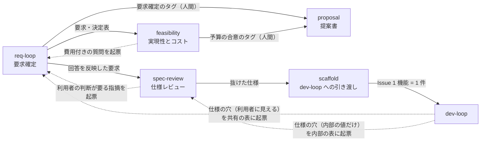

# spec-loop の流れと Red テスト（要求から dev-loop の Issue まで）

spec-loop は、dev-loop の**手前にある要求側のループ**です。5 本のスキルが正本リポジトリのデータを読み書きしながら、
利用者の回答・予算責任者の合意・決裁者の承認を待って止まり、最後に**確定した仕様を Red テストと Issue に変えて** dev-loop に渡します。
このページは、その**流れと部品の場所**、とくに公開ページから辿りにくかった **Red テストと `--red-check`**、
仕様レビューの **[形式検査（Z3・TLC・Alloy）](#formal)**、正本リポジトリの **[ドキュメントの道具（図の書き出し・MkDocs の雛形）](#doc-tools)** を案内します。
スキルごとの説明とインストールは [プラグイン一覧の「spec-loop」](index.md#spec-loop) にあります。
仕様レビューと実現性・コストを利用者の不在のあいだに 1 単位ずつ回す入口 `autopilot` の回し方は [spec-loop の autopilot](spec-loop-autopilot.md) にあります。

!!! warning "規範はプラグインの中にあります"
    このページは**部品の場所と流れの案内**です。決まり（データの列・判定の表・終了コード・何を守り何を守らないか）は
    [プラグインの `references/`](https://github.com/hdknr/claude-code-setup/tree/main/plugins/spec-loop/references)、
    [各スキルの `SKILL.md`](https://github.com/hdknr/claude-code-setup/tree/main/plugins/spec-loop/skills)、
    [スクリプトの docstring](https://github.com/hdknr/claude-code-setup/tree/main/plugins/spec-loop/scripts) を正とします。
    **ここに書き写すと片方だけが古くなる**ので、要点と指し先しか書いていません。

## 5 本のスキルの流れ { #flow }



実線は次に渡すもの、点線は **Q&A 表への起票による差し戻し**です。共有の Q&A 表の質問は `req-loop` のレビュー会で利用者に答えてもらい、
内部の Q&A 表の行は開発者が決めて `spec-review` が仕様に反映します（2 つの層の説明は [プラグイン一覧の `req-loop` の節](index.md#spec-loop)）。

| スキル | 何を読んで何を書くか | 何を待って止まるか | 次に渡すもの |
| --- | --- | --- | --- |
| `req-loop` | Q&A 表の回答を要求・決定表に反映し、未決定事項を質問として起票して、レビュー会の PPTX を作る | **利用者の回答待ち** | 回答を反映した要求。暫定の回答が残らなければ、利用者が要求確定のタグを付けられる |
| `spec-review` | 要求から開発者向けの仕様を書き下し、3 つの判定役にレビューさせて指摘を振り分ける（判定役の 1 つが[形式検査](#formal)をする） | 抜ける条件の判定を報告して止まる。**利用者の判断が要る指摘は起票して回答待ち** | 抜けた仕様（`scaffold` の入力） |
| `feasibility` | 要求から規模を数え、見積りとスケジュール・ガントチャートを作り、費用付きの質問を起票する | **予算責任者の合意待ち**（費用付きの質問は回答待ち） | 見積りとスケジュール。合意したら予算責任者が予算の合意のタグを付ける |
| `proposal` | 2 つのサインオフのタグが同じ中身を見ていたかを照合し、一致したときだけ提案書と仕様書を作る | **決裁者の承認待ち**（照合が通らなければ、どちらの承認を取り直すかを示して止まる） | 提案書 |
| `scaffold` | 仕様を中間表現に書き起こし、スクリプトで OpenAPI・型・Red テスト・Issue の本文を作る | **Issue の登録の前に利用者に確かめ**、登録で止まる（commit の決まりが無ければ、その前に変更したファイルを示して止まり、push されるまで登録しない） | Issue（以降は dev-loop） |

- **タグはどのスキルも付けません。** 要求確定・予算の合意・リリース（凍結）のタグは人間が付けます
  （命名と照合は [`signoff-tags.md`](https://github.com/hdknr/claude-code-setup/blob/main/plugins/spec-loop/references/signoff-tags.md)、
  凍結は [`versions.md`](https://github.com/hdknr/claude-code-setup/blob/main/plugins/spec-loop/references/versions.md) を正とします）。
- **`scaffold` が入力で確かめるのは、仕様レビューを抜けたことです**（抜ける条件 1 をスクリプトで、条件 2〜5 は直近の `spec-review` の報告を利用者に確かめる）。
  提案書の承認は確かめません——表の順は、ふつうに進めたときの順です。
- 各スキルの止まり方の詳細は [プラグイン一覧の「spec-loop」](index.md#spec-loop) の各節、手順は各スキルの `SKILL.md` を正とします。
- **`spec-review` と `feasibility` は、利用者が居ないあいだに `autopilot` で 1 単位ずつ回せます**——訊く場面を起動時に確かめた線で置き換え、線に無い判断では止まります。
  タグ・`scaffold`・Issue の登録はしません（[spec-loop の autopilot](spec-loop-autopilot.md)）。

## 正本リポジトリのデータ { #data }

spec-loop は、要求・仕様・見積りを **1 つの git リポジトリ（正本）** に置き、版ごとのディレクトリ `docs/v<n>/` で持ちます
（版の要点は [プラグイン一覧の「正本リポジトリの版と凍結」](index.md#spec-loop-versions)）。
どこに何を置くかは [`tree.md`](https://github.com/hdknr/claude-code-setup/blob/main/plugins/spec-loop/references/tree.md)、
版の決まりは [`versions.md`](https://github.com/hdknr/claude-code-setup/blob/main/plugins/spec-loop/references/versions.md) を正とします。

表は**主な**書き手と読み手で、全部ではありません（全部は各スキルの `SKILL.md` と dev-loop の `spec-gap.md`）。

| データ | 書く | 読む | 決まりの原本 |
| --- | --- | --- | --- |
| 共有の Q&A 表（`shared/qa.csv`） | 起票: `req-loop`・`spec-review`・`feasibility`・dev-loop（仕様の穴）。回答: 利用者。反映先と状態: 反映したスキル | `req-loop`（資料）・`spec-review`・`feasibility`・`proposal`（暫定の回答の照合）・`scaffold`（関門と Issue の本文）・dev-loop（回答の正） | [`qa-csv.md`](https://github.com/hdknr/claude-code-setup/blob/main/plugins/spec-loop/references/qa-csv.md) |
| 内部の Q&A 表（`spec/qa-dev.csv`） | `spec-review`・`feasibility`・dev-loop（仕様の穴）。開発者が決めて記録する | `spec-review`・`scaffold`（抜ける条件 1 は共有と内部の両方の表を見る）・`feasibility`（費用の行を見積りに拾う）・dev-loop（回答の正） | 同上の「層」 |
| 要求と決定表（`requirements/`・`shared/decision_table.csv`） | `req-loop`（回答の反映） | `spec-review`（書き下す元）・`feasibility`（規模を数える）・`proposal`（提案書と仕様書） | `tree.md` |
| 仕様（`spec/`） | `spec-review` | `scaffold`（中間表現に書き起こす）・`feasibility`（数え方を確かめる）・`proposal`（仕様書） | [`spec-exit.md`](https://github.com/hdknr/claude-code-setup/blob/main/plugins/spec-loop/references/spec-exit.md)・[`spec-scope.md`](https://github.com/hdknr/claude-code-setup/blob/main/plugins/spec-loop/references/spec-scope.md) |
| スケジュールと見積り（`feasibility/schedule.csv`・`estimate.csv`） | `feasibility` | `proposal` | [`feasibility-csv.md`](https://github.com/hdknr/claude-code-setup/blob/main/plugins/spec-loop/references/feasibility-csv.md) |
| 形式検査のモデル（`spec/formal/<対象>/`） | `spec-review`（Formal Checker が走らせたモデルを写す） | `spec-review`（次の回に Formal Checker へ渡す。版の重ね合わせで次の版にも渡る）。**上の「仕様」の行の `proposal` の仕様書には入らない** | `tree.md` の「形式検査のモデル」（下の「[モデルの置き場所と次の回](#formal-models)」） |
| サインオフのタグ | 人間（利用者・予算責任者） | `proposal`（照合） | `signoff-tags.md` |
| 中間表現（`spec/spec_ir.json`） | `scaffold`（スキルが書き起こす） | `scaffold.py`・`proposal`（仕様書の機能の一覧）・dev-loop（機能の指紋） | [`spec-ir.md`](https://github.com/hdknr/claude-code-setup/blob/main/plugins/spec-loop/references/spec-ir.md) |
| 契約（`scaffold/` の OpenAPI・型・Red テスト） | `scaffold.py`（生成。commit する） | dev-loop（Red テストを回す） | `tree.md` の「scaffold の出力」 |
| 図（drawio・BPMN のソースと、隣の書き出し `.svg`） | ソース: 文書を書くスキルと人。書き出し: `render-diagrams.py` | `proposal`（仕様書は `spec/`・`requirements/` の `.svg` を載せる）・表示のサイト | `tree.md` の「図」（下の「[図](#doc-diagrams)」） |
| 表示のサイト（MkDocs の設定・フック・表示用のページ） | `init-mkdocs.py`（雛形を写す。`req-loop` が呼ぶ） | 人（`uv run mkdocs serve`。フックが Q&A 表と決定表を CSV から描く） | `tree.md` の「ドキュメントのツール」（下の「[表示のサイト（MkDocs の雛形）](#doc-mkdocs)」） |

## 正本リポジトリのドキュメントの道具 { #doc-tools }

正本リポジトリの文書を**図つきで書き、ブラウザで読める**ようにする道具が 2 つ同梱されています。
どちらも決まりの原本は [`tree.md`](https://github.com/hdknr/claude-code-setup/blob/main/plugins/spec-loop/references/tree.md) で、
このページは要点と指し先だけを書きます（使い方の要約は [プラグインの `README.md`](https://github.com/hdknr/claude-code-setup/blob/main/plugins/spec-loop/README.md)）。

| 道具 | 何をするか | 決まりの原本 | 振る舞いの原本（終了コード・守らないもの） |
| --- | --- | --- | --- |
| `render-diagrams.py`（BPMN は `render-bpmn.mjs` を呼ぶ） | `docs/` の下の drawio と BPMN を隣の `.svg` に書き出し、ソースの指紋を書き込む。`--check` は鮮度だけを見る | `tree.md` の「図」 | [`render-diagrams.py`](https://github.com/hdknr/claude-code-setup/blob/main/plugins/spec-loop/scripts/render-diagrams.py) の docstring |
| `init-mkdocs.py`（雛形は `templates/mkdocs/`） | 正本リポジトリを MkDocs で閲覧できるように、設定・フック・表示用のページを写す | `tree.md` の「ドキュメントのツール」 | [`init-mkdocs.py`](https://github.com/hdknr/claude-code-setup/blob/main/plugins/spec-loop/scripts/init-mkdocs.py) の docstring |

### 図 { #doc-diagrams }

- **正本リポジトリの図は、アスキーアートでも Mermaid でも描きません。** 業務フロー（担当をレーンで分けた業務の手順の流れ）は **BPMN**（`<名前>.bpmn`。Camunda Modeler で編集できる）で、
  それ以外の図（構成・関係・画面や状態の遷移など）は **drawio**（`<名前>.drawio`）で描き、どちらも SVG に書き出します。
  ディレクトリの一覧や表はテキストのままでかまいません。どちらで描くかの線・描かないもの・対象の外（スクリプトが生成するガントチャートなど）は `tree.md` の「図」を正とします。
  （このページの流れの図は Mermaid ですが、それはこのサイトの図で、正本リポジトリの決まりとは別です。）
- **置き場所**: drawio は**図を使う文書と同じディレクトリ**に、BPMN は版の中の **`requirements/flows/`** に置き、どちらも隣に同じ名前の書き出し `<名前>.svg` を置いて、
  **ソースと書き出しを一緒に commit します**。版の外（`docs/assets/` など）に置くと、2 つの承認が比べる範囲から外れます（`tree.md` の「図」と「業務フロー（BPMN）」）。
- **書き出しと確かめ方**: 同梱のスクリプトで書き出します。書き出しを手で作らず、印も手で書き換えません。

  ```bash
  python3 <spec-loop の base ディレクトリ>/scripts/render-diagrams.py [<正本リポジトリの根>]          # 書き出す
  python3 <spec-loop の base ディレクトリ>/scripts/render-diagrams.py [<正本リポジトリの根>] --check  # 確かめる
  ```

  `--check` は描画系（draw.io・Node・Chrome）を起動せず何も書かずに、書き出しが無い・古い・印が無い図と、ソースの無い書き出しを名指しします（CI でも回せます）。
- **書き出しに要るもの**: drawio は draw.io の CLI（環境変数 `DRAWIO`。無ければ macOS の既定の場所、`PATH` の `drawio` の順に探す）。
  BPMN は Node（`PATH` の `node`）・bpmn-js と puppeteer-core（**正本リポジトリの外の**ディレクトリで `npm install bpmn-js puppeteer-core` を走らせ、そのディレクトリを `SPEC_LOOP_BPMN_DEPS` で渡す）・
  Chrome（`CHROME_PATH`。無ければ macOS の既定の場所）です。**`--check` にはどれも要りません。**
  **在るソースの種類に要るものが 1 つでも無ければ**（`.drawio` があるのに draw.io の CLI が無い・`.bpmn` があるのに BPMN に要るものが無い）、**どちらの種類も 1 件も書かずに、無いものと書き出していないソースを名指しして止まります。**
  探す順・描画口の差し替え（`BPMN_RENDER`）・時間切れ・確かめた版は `render-diagrams.py` の docstring を正とします。
- **鮮度はバイトではなく、ソースの指紋で見ます。** 書き出しにはソースのバイトの sha256 を印として書き込み、`--check` はその印と今のソースを比べます。
  draw.io は同じソースからでもバイトの一致する書き出しを作らないので、書き出し直したものとのバイト比較は「変わっていないのに違う」と出ます
  ——このリポジトリの [`CLAUDE.md`](https://github.com/hdknr/claude-code-setup/blob/main/CLAUDE.md) の「書き出し忘れは差分では見えない」と同じ理由です。
  そのため、**印だけを手で書き換えて書き出さない形は見えません**（docstring の「守らないもの」）。
- **承認の前に `--check` を回します。** 仕様書（`proposal`）は承認したタグの時点の `.svg` を載せ、書き出しの無い図と、書き出しが今のソースと合わない図を名指しします（#902）。
  タグの後に書き出すと 2 つの承認が見た中身が変わるので、書き出して commit してから承認を取ります（`tree.md` の「図」）。

### 表示のサイト（MkDocs の雛形） { #doc-mkdocs }

- **既定のドキュメントのツールは MkDocs です。** プラグインの雛形（`templates/mkdocs/`）を、同梱のスクリプトで正本リポジトリへ写します（手で写しません。`req-loop` も同じスクリプトを呼びます）:

  ```bash
  python3 <spec-loop の base ディレクトリ>/scripts/init-mkdocs.py [<正本リポジトリの根>] [--dry-run]
  ```

  閲覧は正本リポジトリで `uv run mkdocs serve` です。
- **写すのは、正本の `CLAUDE.md` がドキュメントのツールを決めておらず、MkDocs の設定（`mkdocs.yml`・`mkdocs.yaml`）も無いときだけです。**
  設定が在ればスクリプトは何も写さず、**在るファイルは 1 バイトも変えません**——`pyproject.toml`・`.gitignore` が在れば触らずに、足りない依存・行を示します（足すかは利用者が決めます）。
  何を写すか・どこに置くかは `tree.md` の「ドキュメントのツール」を、`--dry-run` と終了コードは `init-mkdocs.py` の docstring を正とします。
- **Q&A 表と決定表は CSV のまま描きます。** 表示用のページ（`docs/qa.md`・`docs/decision-table.md`）に印を書き、写したフックが各版の CSV を版ごとの節に描きます。
  本文の Q&A の番号（`Q-008`）は、フックが Q&A 表のページへのリンクにします（番号の書き方は [`qa-csv.md`](https://github.com/hdknr/claude-code-setup/blob/main/plugins/spec-loop/references/qa-csv.md) の「本文での番号」）。
- **フックは標準ライブラリだけで単独で動きます**——正本リポジトリへ写された後は、プラグインを読み込みません。
  だから**既に写した正本には新しいフックは届きません**。フックを新しくするときは `tree.md` の「Q&A 表を移す」の手順 4 で取り込みます。
- **MkDocs 以外のツール・サイトの分け方は、正本リポジトリの `CLAUDE.md` に書きます。** 書いてあれば、そちらが既定より先に立ちます（`tree.md` の「プロジェクトに任せること」）。

## 形式検査 { #formal }

`spec-review` の判定役のうち **Formal Checker** は、仕様の一部を**形式化して検査器に掛け**、抜け・矛盾・反例を探させます。
仕様レビューを抜ける**条件 4**（形式検査の対象ごとに、検査器が範囲の中で反例を出さず、空振りでない。対象が無ければ「対象なし」と書く）を判定する役です
（3 つの判定役の一覧は [プラグイン一覧の「3 つの判定役」](index.md#spec-loop-judges)）。
対象と選び方の原本は [`spec-exit.md`](https://github.com/hdknr/claude-code-setup/blob/main/plugins/spec-loop/references/spec-exit.md) の「形式検査の対象」、
Formal Checker の手順（道具の使い方・報告の形）の原本は [`formal-checker.md`](https://github.com/hdknr/claude-code-setup/blob/main/plugins/spec-loop/agents/formal-checker.md) です。

### 道具 { #formal-tools }

対象ごとの道具は次のとおりです（`spec-review` が正本リポジトリの `CLAUDE.md` から拾って Formal Checker に渡します）。**画面・文言・使い勝手と、順番どおりに進むだけのフローは対象にしません。**

| 対象 | 道具 | 何を形式化し、何を見つけるか | 必須か | 道具が無いとき |
| --- | --- | --- | --- | --- |
| 決定表・計算ルール | **Z3**（SMT ソルバー） | 決定表の行と計算ルールを条件式にして、どのルールにも当たらない入力（抜け）と、2 つのルールが違う結果を返す入力（矛盾）を探す | 必須ではない。正本リポジトリの `CLAUDE.md` に指定が無ければ、Formal Checker が手元にあるかを確かめて使う（入れはしない） | **Python 標準ライブラリの総当たりで代用する**（各入力を境界値と代表値に分けて組み合わせる） |
| 並行・リトライ・取り消しを含む業務フロー | **TLC**（TLA+ のモデル検査器） | 業務フローを状態と遷移として書き、通信断や同時操作でデータが食い違ったまま残る実行順を探す | **既定で必須の前提**（#912）。正本の `CLAUDE.md` の `TLC の呼び方:` の行だけを使い、`command -v` では探さない。業務フローを一度も形式検査しない正本は `業務フローの形式検査: しない` で `autopilot` の点検から外せる（宣言しても、`spec-review` が業務フローを対象に選んだ回は TLC を確かめ、無ければそこで止まる——`autopilot` もその回は止まる） | **代用しない**（実行順を手で区切ると、区切り方が結果を決める）。`spec-review` は判定役を起動せずに、用意してから呼び直すか、用意せずに進める（業務フローは判定できず、その回は抜けない）かを訊く（狭いパスの直しで増えた対象の検査器が無いときは、訊かずにその対象を「判定できなかった」とする。場面ごとの扱いは `spec-review` の `SKILL.md` 手順 3・5）。`autopilot` は（外す宣言が無ければ）Formal Checker を起こす段の始めで止まる |
| 権限・ロール | **Alloy** | ロール・権限・データの関係を書き、見えてはいけないデータが見えてしまう組み合わせを探す | 必須ではない——権限・ロールを対象に選んだ回だけ要る（#922）。正本の `CLAUDE.md` の `Alloy の呼び方:` の行（`exec` まで含めた形）だけを使い、`command -v` では探さない。**引数なし・`gui` の形では呼ばない**（Alloy 6 の jar はどちらでも画面を開き、検査がそこで止まる） | **代用しない**。`spec-review` は判定役を起動せずに訊く（TLC と同じく、狭いパスの直しで増えた対象の検査器が無いときは訊かない）。`autopilot` は起動時の点検では見ず、権限・ロールを対象に選んだ回に確かめて、無ければ止まる。Formal Checker は呼び方を渡されなければ「検査できなかった」と報告する |

道具そのものの位置づけ:

- **Z3** は SMT ソルバーです——論理式に整数・実数などの理論を加えた制約を満たす値があるかを決め、あれば例を返します（[Z3](https://github.com/Z3Prover/z3)）。
- **TLA+** は状態と遷移で並行システムを書く仕様の言語で、**TLC** はそのモデル検査器です——有限の構成で到達しうる状態をたどり、不変条件を破る実行順を反例として返します（[TLA+](https://lamport.azurewebsites.net/tla/tla.html)）。
- **Alloy** は関係論理で構造を書く言語と分析器です——与えた範囲（要素の数の上限）の中で、性質を破る例を探します（[Alloy](https://alloytools.org/)）。

呼び方の行の書き方・確かめ方・終了コードは [`check-tlc.py`](https://github.com/hdknr/claude-code-setup/blob/main/plugins/spec-loop/scripts/check-tlc.py) と
[`check-alloy.py`](https://github.com/hdknr/claude-code-setup/blob/main/plugins/spec-loop/scripts/check-alloy.py) の docstring、
用意のしかた（Java と jar の置き方）は [プラグインの README の「前提」](https://github.com/hdknr/claude-code-setup/blob/main/plugins/spec-loop/README.md#前提) を正とします。
前から使っている正本の移行（0.73.0 の TLC・0.75.0 の Alloy）は `spec-exit.md` の各節にあります。

### 対象の選び方 { #formal-scope }

表の対象があっても、毎回検査するのではありません。**作業中の版の改修の性質で選び、検査の深さを改修の大きさに釣り合わせます**
（既存の書き手に排他を足すだけの改修をどう扱うかを含む。#373・#909）。
どれを対象にするかは `spec-review`（仕様を書く側）が理由と一緒に Formal Checker に渡します。

**線と例は `spec-exit.md` の「改修の性質で選ぶ」を正とします**（ここに表を写していません）。

### 「反例なし」を空振りにしない { #formal-vacuity }

- **判定は検査器の出力で決めます。** Formal Checker の「問題ありません」は判定にしません。
- **「反例なし」と言えるのは、次の 2 つを示したときだけです**——正常な状態に到達できること（モデルが何も許さない形になっていない）と、
  わざと壊したモデルで反例が出ること（陽性対照）。どちらも無ければ、反例が出ないのは検査が空振りしただけかもしれません。
- **検査できなかった対象は、抜ける条件を満たしません**——判定できなかったものを「満たす」に寄せません。
- 形式化のために置いた前提（端数処理・割引の適用順など）は形式化した側の解釈なので、利用者の判断が要るなら Q&A 表で確かめます。

### モデルの置き場所と次の回 { #formal-models }

Formal Checker はリポジトリの外でモデルを組んで走らせ、**`spec-review` が検査器の走った対象のモデルと設定をそのまま**作業中の版の
`docs/v<n>/spec/formal/<対象>/` に写し、記録の `README.md`（結果・陽性対照・置いた前提・前回のモデルをどう使ったか など）を書きます（#908）。
走らせていない（判定できなかった）対象のモデルは残しません。

- **次の回（次の周・次の版）は保存したモデルから始めます。** 仕様が変わっていなければ直さずに走らせ、前回と同じモデルで「反例なし」が続くことが回帰の確かめになります。
  前回の「置いた前提」は引き継ぐものではなく、確かめ直す対象です。
- **`spec/formal/` は仕様から書き起こした写しです。** 版の重ね合わせには入り（次の版に前の版のモデルが渡る）、
  **2 つのサインオフの照合・版の差分・仕様書（規模・図・ファイルの一覧）・抜ける条件 1 の未決定の印と条件 2 の定義の突き合わせには入りません**——モデルは保存するたびに文字列が変わり、承認する人が読むのは仕様の本文だからです。

**置き方・記録の項目・どこに入れないかは [`tree.md`](https://github.com/hdknr/claude-code-setup/blob/main/plugins/spec-loop/references/tree.md) の「形式検査のモデル」、
写す手順は [`spec-review` の `SKILL.md`](https://github.com/hdknr/claude-code-setup/blob/main/plugins/spec-loop/skills/spec-review/SKILL.md) の手順 3 の「モデルを残す」を正とします。**

### Red テストとの違い { #formal-vs-red }

| | Red テスト（[下](#red-test)） | 形式検査 |
| --- | --- | --- |
| いつ・誰が | `scaffold` が中間表現から生成し、実装に当てる（dev-loop の受入基準・[`--red-check`](#red-check)） | `spec-review` の中で Formal Checker が検査器に掛ける |
| 何を見るか | 仕様のテストケース——関数の入力と出力のケースと、反例のトレースを再現するケース（下） | 仕様の水準の性質——決めた範囲・構成の中で、抜け・矛盾・性質を破る実行順や組み合わせを探す |
| 何に当てるか | 実装 | 仕様から書き起こしたモデル（実装には当てない） |

**2 つは反例のトレースでつながります**（#923）。Formal Checker が範囲の中の反例を出して仕様を直したら、`spec-review` はその反例の実行順
（呼び出し・モデルの行為の名前で書いた段の順・初めの状態・結果）を仕様のテストケースとして書き、`scaffold` がそれを**トレースのケース**に書き起こします。
そこから作る Red テストは、実装に `checkpoint`（段の前で呼ぶ口）と `reset_state` を求め、呼び出しを同時に走らせて**反例と同じ順を実装の口で強制し**、
同じ誤りが起きないことを確かめます——仕様を直した後の回帰になります。ただし順を強制できないとき（呼び出しが排他を待って段に来ない）は強制をやめて全部を走らせ、
負荷や口の約束を破る実装では競合を見逃すことがあります（`spec-ir.md` の「トレースのケース」の「守らないこと」）。

**Red テストが実装で確かめる実行順は、仕様に書いたトレースの順だけです**——形式検査が「反例なし」とした性質を、実装が全部の順で守ることは確かめません
（下の「[守らないもの](#limits)」）。ケースの形・実装に求める口・Red テストが確かめることと守らないことは
[`spec-ir.md`](https://github.com/hdknr/claude-code-setup/blob/main/plugins/spec-loop/references/spec-ir.md) の「トレースのケース」を正とします。

## Red テスト { #red-test }

**Red テスト**は、`scaffold` が仕様から生成する**実装が無いと失敗するテスト**です。dev-loop に渡す Issue の受入基準そのものになります。

- **どこから作られるか**: 中間表現（`spec_ir.json`）の機能ごとに、テストのファイルが 1 本（`scaffold/tests/test_<機能>.py`）でき、
  **機能の `cases` のケース 1 つがテストのメソッド 1 つ**になります。ケースは仕様のテストケースから写したもので、
  **中間表現に書いていないケースは生成されません**（中間表現の形は [`spec-ir.md`](https://github.com/hdknr/claude-code-setup/blob/main/plugins/spec-loop/references/spec-ir.md) を正とします）。
- **どんな形か**: Python の `unittest` です。中間表現の `impl_module`（省けば `spec_impl`）を読み込み、入口（`operation.id`）の名前の関数を
  ケースの入力で呼んで、返したものが期待（正常なら `expected`、失敗するケースなら `{"error": …}`）と等しいことと、出力の各項目の型を見ます。
  **モジュールか関数が無ければ `未実装:` で失敗します**——これが「実装が無いと失敗する（赤）」の正体です。
- **反例のトレースのケース**（#923）は形が違います——`input`・`expected`・`error` の代わりに、同時に走らせる呼び出し・段の順・結果の期待（呼び出しの結果か、後の状態）を持ち、実装の口で順を強制します（上の「[Red テストとの違い](#formal-vs-red)」）。
- **何が赤・緑の期待か**: 足した・変えたケースは、この版を実装する前は**赤**です（前の版の実装がもう満たすケースは緑でありえます）。
  追加の Issue の受入基準は**表の Red テストがすべて緑になること**、変更の Issue はそれに加えて変えていないケース（回帰）も緑であることです。
  変更と撤去の Issue では、**ほかの機能の Red テストは「周の前に緑だったものが、周の後も緑のまま」であること**を求めます——
  同じ版のほかの Issue がまだ実装されていなければ、そのテストは赤のままでかまいません（「全部が緑」ではありません）
  （本文の形は [`handoff-issue.md`](https://github.com/hdknr/claude-code-setup/blob/main/plugins/spec-loop/references/handoff-issue.md)、
  dev-loop の側の受入基準の写し方は dev-loop の [`spec-gap.md`](https://github.com/hdknr/claude-code-setup/blob/main/plugins/dev-loop/skills/dev-loop/references/spec-gap.md) を正とします）。
- **Red テストは手で直しません。** 期待を変えたいなら、仕様（と Q&A 表）を直して作り直します。

### `--red-check` が見るもの { #red-check }

`scaffold.py --red-check` は、置いてある `scaffold/` が今の中間表現から作るものと同じ（新しい）ことを確かめてから、
Red テストを正本リポジトリの根で走らせ、**いまの実装に対して Red テストが期待どおりの赤・緑になっているか**を見ます。

- **実装が無いとき**: 回帰のケース（前の版から変えていないケース。変えた機能の中のものも含む）が無ければ判定でき（v1 はこれにあたります）、足した・変えたケースが失敗するのが期待どおりです。
  回帰のケースがあれば、それを判定していないとして 2 で終わります——`scaffold` スキルはそこで止まらず、Red の状態を確かめていないと示して進みます
  （正本と開発のリポジトリが別の場合。扱いは `scaffold` の `SKILL.md` の手順 4）。
- **v2 以降**: Red テストは「実装が前の版の状態にある」ことを前提にしません。そこで**前の版の全体からも Red テストを作り、同じ実装に当てます**。
  変えていないケース（回帰）は緑であること、足した・変えたケースは作業中の版で失敗し前の版で緑か前の版に無い（まだこの版を実装していない）か、
  前の版の実装がもう満たしている（「もう緑」と名指しして知らせる）ことなどを見ます（どちらの版でも「未実装」で落ちるなど、ほかの形は docstring）。
- **`--in-progress`**: この版の Issue を登録して実装が始まったあとの**作り直し**で使います。作業中の版の期待をもう満たしたケースを実装済みとして数え、止めません。

**判定の本体（ケースごとの判定の表・終了コード・何を守らないか）は
[`scaffold.py` の docstring](https://github.com/hdknr/claude-code-setup/blob/main/plugins/spec-loop/scripts/scaffold.py) を正とします。**
結果が期待と違ったときにどう扱うか（乖離として扱うか、作りかけの実装の誤りとして dev-loop の周に返すか）は、
[`scaffold` の `SKILL.md`](https://github.com/hdknr/claude-code-setup/blob/main/plugins/spec-loop/skills/scaffold/SKILL.md) の手順 4 を正とします。

## dev-loop への引き渡し { #handoff }

2 つのプラグインの境界は、**`scaffold` が登録する Issue と、そこから指すファイル**（中間表現・Red テスト）です。
dev-loop は Issue 1 件を読むだけで周を始められるよう、本文から受入基準・Red テスト・Q&A の回答・仕様の原文を辿れます。

- **1 機能の変化 = Issue 1 件**です。v2 以降は前の版と比べて変わった機能（追加・変更・削除）だけを Issue にします（凍結した前の版の時点が崩れていたときの例外は `handoff-issue.md`）。
  同じモジュール・同じ受入基準・同じデプロイ経路の機能を 1 件で渡したいときだけ、scaffold を回す人が `scaffold.py --bundle F-001,F-002` で選んでまとめます
  （変化が揃う機能だけ。まとめた本文は機能ごとの部分を並べ、部分ごとに指紋と sha256 を持ちます）。
- **依存の連鎖は cruise の親 Issue の書式で出せます。** 呼ぶ機能（入口）の Issue は呼ばれる機能（判定の関数）の Issue に依存し、`issues.json` の `depends` に載ります。
  登録した後に `parent-checklist.py` が、登録した Issue の一覧から `- [ ] #12 F-001 (depends: #11)` の行を作ります——そのまま dev-loop の cruise の親 Issue に貼れます
  （書き方は [`handoff-issue.md`](https://github.com/hdknr/claude-code-setup/blob/main/plugins/spec-loop/references/handoff-issue.md) の「まとめた本文」「依存の連鎖」）。
- **本文は「何を作らないか」も渡します**（`## 作らないもの`）。その機能に関わる範囲の外の行と次の版の候補を範囲の文書から原文のまま写し、
  性能予算には、性能の要求の表（`shared/nfr.csv`）の行のうち中間表現の `nfr` が指す行の数字と性能テストを、行が無ければ「要求なし——速さのための最適化をしない」と書きます。
  どの行が関わるかは中間表現（`out_of_scope`・`nfr`）に書き起こし、スクリプトは行が在ることを確かめます。性能テストは負荷を再現しないので、受入基準ではなく、最適化してよいかを決める計測の道具です
  （列と手順は [`nfr.md`](https://github.com/hdknr/claude-code-setup/blob/main/plugins/spec-loop/references/nfr.md)）。
- **Issue の外に、課題一覧（案）も出します**（`build/scaffold/issues/proposals.md`）。Red テストは入口の関数を呼んだ結果しか確かめないので（トレースのケースも入口を呼ぶ）、
  入口の機能を呼ぶ側の結線（入力が遅れる・呼ぶ処理がやり直される、など）は Red テストの外に残ります。追加・変更した入口の機能（`impl_module` を変えただけのものを除く）ごとに 1 案を置き、
  **未決定事項**（中間表現の `branches` に書き起こしていない呼ぶ側の分岐）・**受入基準の雛形**（見せるものの仕様の原文）・**作らないもの**を付けます。
  `scaffold` は案を登録しません——未決定事項のある案は、登録の前に `spec-review` に戻します
  （決まりは [`spec-ir.md`](https://github.com/hdknr/claude-code-setup/blob/main/plugins/spec-loop/references/spec-ir.md) の「呼ぶ側の分岐」）。
- **本文は先頭の印で spec-loop から来たと分かります。** dev-loop はこの印を見て、spec-loop から来た Issue の読み方に切り替えます。
- **追加・変更の本文は、中間表現の中のその機能の指紋と、Red テストのファイルの sha256 を持ちます。** dev-loop は実装に入る前に、手元のファイルが Issue の時点と同じかを確かめ、
  違えば差し戻します。撤去の本文は sha256 を持たず（消したファイルなので）、指紋は前の版の全体で確かめます。指紋は機能単位なので、関係の無い機能を直しても登録済みの Issue は不一致になりません。
- **本文は仕様の基準コミット（正本リポジトリで本文を生成した時点の HEAD とその日時）も持ちます。** 指紋と sha256 は仕様の時点を固定しますが、
  仕様が前提にした既存のシステムの時点は固定しません。dev-loop は周の頭で、基準コミットから後の変化が仕様の前提を崩していないかを点検し、
  崩していれば仕様の穴として差し戻します（書き方は [`handoff-issue.md`](https://github.com/hdknr/claude-code-setup/blob/main/plugins/spec-loop/references/handoff-issue.md) の「基準コミット」）。
- **利用者が仮回答（`暫定反映`）のまま開発へ渡すと決めたときだけ、`scaffold.py --provisional` で作ります。** 既定では仮回答が 1 行でも残れば作りません。
  旗を付けると、仮回答に依存する本文の `## 仕様` に `- 仮回答: ` の行を、受入基準の表で仮回答を根拠にするケースに `（暫定）` を付けます。
  利用者が確かめて回答が変わったら、作り直す範囲（Issue と受入基準のケース）を `rebuild-scope.py` が登録した Issue から引きます。dev-loop が推奨で決めた事項（確認の Issue）と、閉じたときに推奨のままだったか値を変えたかも同じ入力から引けます
  （書き方は [`handoff-issue.md`](https://github.com/hdknr/claude-code-setup/blob/main/plugins/spec-loop/references/handoff-issue.md) の「仮回答の印」）。
- **開発中に仕様の穴が見つかったら、dev-loop は実装で決めず、作業中の版の Q&A 表に起票元 `開発` で起票して要求側に差し戻します。**
  利用者に見える結果が変わる穴は共有の表に、そうでなければ内部の表に起票します。回答は共有の行なら `req-loop`、内部の行なら `spec-review` が仕様に反映し、
  仕様レビューを抜けてから `scaffold` で作り直します（`--red-check --in-progress`）。

本文の形（印・節・変化の値・指紋の式）は
[`handoff-issue.md`](https://github.com/hdknr/claude-code-setup/blob/main/plugins/spec-loop/references/handoff-issue.md)、
dev-loop の側の読み方・確かめ方・差し戻し方は dev-loop の
[`spec-gap.md`](https://github.com/hdknr/claude-code-setup/blob/main/plugins/dev-loop/skills/dev-loop/references/spec-gap.md) を正とします。

## 守らないもの { #limits }

生成と検査はスクリプトが行いますが、**スクリプトが見ているのは形と出所まで**です。要点は次の 3 つです。

- **中間表現が仕様と意味で一致するか**は見ません。仕様を中間表現に書き起こすのは `scaffold`（LLM）の判断で、スクリプトが見るのは出所
  （指した仕様と Q&A が在り、Q&A が確定していること）までです。
- **Red テストが仕様のケースを漏れなく持つか**は見ません。中間表現に書いたケースだけが Red テストになり、漏れは書き起こしの側で見ます。
- **`--red-check` が回した実装が、開発のリポジトリの実装か**は見ません。走らせるのは正本リポジトリの根で読み込める実装です。

全部は [`scaffold.py` の docstring](https://github.com/hdknr/claude-code-setup/blob/main/plugins/spec-loop/scripts/scaffold.py) の「この生成が守らないもの」、
ほかのスクリプトはそれぞれの docstring を正とします。

形式検査（スクリプトではなく判定役と検査器が行う）についても 1 つあります:

- **形式検査の「反例なし」は、実装がその性質を守ることを言いません。** 検査器が見るのは仕様から書き起こしたモデルです。
  実装に当たるのは Red テストで、実行順を確かめるのは仕様に書いた反例のトレースの順だけです——その順も、強制をやめたときや負荷のもとでは見逃すことがあります
  （トレースのケースの守らないことは `spec-ir.md` の「トレースのケース」。上の「[Red テストとの違い](#formal-vs-red)」）。

## 設計の経緯 { #history }

設計の経緯は、各周の計画ファイルに残っています（周の作業記録で、決まりの原本ではありません）。

- [#219](https://github.com/hdknr/claude-code-setup/blob/main/docs/plans/issue-219.md) — `scaffold` と Red テスト、dev-loop への差し戻しの規定
- [#264](https://github.com/hdknr/claude-code-setup/blob/main/docs/plans/issue-264.md) — v2 以降の追加・変更・削除（変わった機能だけを Issue にする）
- [#294](https://github.com/hdknr/claude-code-setup/blob/main/docs/plans/issue-294.md) — Red テストと受入基準が、実装が前の版の状態にあることを前提にしない（`--red-check` が前の版の Red テストも当てる）
