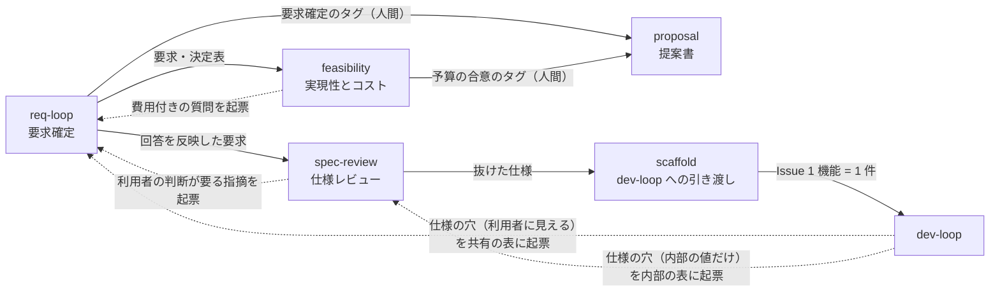

# spec-loop の流れと Red テスト（要求から dev-loop の Issue まで）

spec-loop は、dev-loop の**手前にある要求側のループ**です。5 本のスキルが正本リポジトリのデータを読み書きしながら、
利用者の回答・予算責任者の合意・決裁者の承認を待って止まり、最後に**確定した仕様を Red テストと Issue に変えて** dev-loop に渡します。
このページは、その**流れと部品の場所**、とくに公開ページから辿りにくかった **Red テストと `--red-check`** を案内します。
スキルごとの説明とインストールは [プラグイン一覧の「spec-loop」](index.md#spec-loop) にあります。

!!! warning "規範はプラグインの中にあります"
    このページは**部品の場所と流れの案内**です。決まり（データの列・判定の表・終了コード・何を守り何を守らないか）は
    [プラグインの `references/`](https://github.com/hdknr/claude-code-setup/tree/main/plugins/spec-loop/references)、
    [各スキルの `SKILL.md`](https://github.com/hdknr/claude-code-setup/tree/main/plugins/spec-loop/skills)、
    [スクリプトの docstring](https://github.com/hdknr/claude-code-setup/tree/main/plugins/spec-loop/scripts) を正とします。
    **ここに書き写すと片方だけが古くなる**ので、要点と指し先しか書いていません。

## 5 本のスキルの流れ { #flow }

実線は次に渡すもの、点線は **Q&A 表への起票による差し戻し**です。共有の Q&A 表の質問は `req-loop` のレビュー会で利用者に答えてもらい、
内部の Q&A 表の行は開発者が決めて `spec-review` が仕様に反映します（2 つの層の説明は [プラグイン一覧の `req-loop` の節](index.md#spec-loop)）。

| スキル | 何を読んで何を書くか | 何を待って止まるか | 次に渡すもの |
| --- | --- | --- | --- |
| `req-loop` | Q&A 表の回答を要求・決定表に反映し、未決定事項を質問として起票して、レビュー会の PPTX を作る | **利用者の回答待ち** | 回答を反映した要求。暫定の回答が残らなければ、利用者が要求確定のタグを付けられる |
| `spec-review` | 要求から開発者向けの仕様を書き下し、3 つの判定役にレビューさせて指摘を振り分ける | 抜ける条件の判定を報告して止まる。**利用者の判断が要る指摘は起票して回答待ち** | 抜けた仕様（`scaffold` の入力） |
| `feasibility` | 要求から規模を数え、見積りとスケジュール・ガントチャートを作り、費用付きの質問を起票する | **予算責任者の合意待ち**（費用付きの質問は回答待ち） | 見積りとスケジュール。合意したら予算責任者が予算の合意のタグを付ける |
| `proposal` | 2 つのサインオフのタグが同じ中身を見ていたかを照合し、一致したときだけ提案書と仕様書を作る | **決裁者の承認待ち**（照合が通らなければ、どちらの承認を取り直すかを示して止まる） | 提案書 |
| `scaffold` | 仕様を中間表現に書き起こし、スクリプトで OpenAPI・型・Red テスト・Issue の本文を作る | **Issue の登録の前に利用者に確かめ**、登録で止まる（commit の決まりが無ければ、その前に変更したファイルを示して止まり、push されるまで登録しない） | Issue（以降は dev-loop） |

- **タグはどのスキルも付けません。** 要求確定・予算の合意・リリース（凍結）のタグは人間が付けます
  （命名と照合は [`signoff-tags.md`](https://github.com/hdknr/claude-code-setup/blob/main/plugins/spec-loop/references/signoff-tags.md)、
  凍結は [`versions.md`](https://github.com/hdknr/claude-code-setup/blob/main/plugins/spec-loop/references/versions.md) を正とします）。
- **`scaffold` が入力で確かめるのは、仕様レビューを抜けたことです**（抜ける条件 1 をスクリプトで、条件 2〜5 は直近の `spec-review` の報告を利用者に確かめる）。
  提案書の承認は確かめません——表の順は、ふつうに進めたときの順です。
- 各スキルの止まり方の詳細は [プラグイン一覧の「spec-loop」](index.md#spec-loop) の各節、手順は各スキルの `SKILL.md` を正とします。

## 正本リポジトリのデータ { #data }

spec-loop は、要求・仕様・見積りを **1 つの git リポジトリ（正本）** に置き、版ごとのディレクトリ `docs/v<n>/` で持ちます
（版の要点は [プラグイン一覧の「正本リポジトリの版と凍結」](index.md#spec-loop-versions)）。
どこに何を置くかは [`tree.md`](https://github.com/hdknr/claude-code-setup/blob/main/plugins/spec-loop/references/tree.md)、
版の決まりは [`versions.md`](https://github.com/hdknr/claude-code-setup/blob/main/plugins/spec-loop/references/versions.md) を正とします。

表は**主な**書き手と読み手で、全部ではありません（全部は各スキルの `SKILL.md` と dev-loop の `spec-gap.md`）。

| データ | 書く | 読む | 決まりの原本 |
| --- | --- | --- | --- |
| 共有の Q&A 表（`shared/qa.csv`） | 起票: `req-loop`・`spec-review`・`feasibility`・dev-loop（仕様の穴）。回答: 利用者。反映先と状態: 反映したスキル | `req-loop`（資料）・`spec-review`・`feasibility`・`proposal`（暫定の回答の照合）・`scaffold`（関門と Issue の本文）・dev-loop（回答の正） | [`qa-csv.md`](https://github.com/hdknr/claude-code-setup/blob/main/plugins/spec-loop/references/qa-csv.md) |
| 内部の Q&A 表（`spec/qa-dev.csv`） | `spec-review`・`feasibility`・dev-loop（仕様の穴）。開発者が決めて記録する | `spec-review`・`scaffold`（抜ける条件 1 は共有と内部の両方の表を見る）・`feasibility`（費用の行を見積りに拾う）・dev-loop（回答の正） | 同上の「層」 |
| 要求と決定表（`requirements/`・`shared/decision_table.csv`） | `req-loop`（回答の反映） | `spec-review`（書き下す元）・`feasibility`（規模を数える）・`proposal`（提案書と仕様書） | `tree.md` |
| 仕様（`spec/`） | `spec-review` | `scaffold`（中間表現に書き起こす）・`feasibility`（数え方を確かめる）・`proposal`（仕様書） | [`spec-exit.md`](https://github.com/hdknr/claude-code-setup/blob/main/plugins/spec-loop/references/spec-exit.md)・[`spec-scope.md`](https://github.com/hdknr/claude-code-setup/blob/main/plugins/spec-loop/references/spec-scope.md) |
| スケジュールと見積り（`feasibility/schedule.csv`・`estimate.csv`） | `feasibility` | `proposal` | [`feasibility-csv.md`](https://github.com/hdknr/claude-code-setup/blob/main/plugins/spec-loop/references/feasibility-csv.md) |
| サインオフのタグ | 人間（利用者・予算責任者） | `proposal`（照合） | `signoff-tags.md` |
| 中間表現（`spec/spec_ir.json`） | `scaffold`（スキルが書き起こす） | `scaffold.py`・`proposal`（仕様書の機能の一覧）・dev-loop（機能の指紋） | [`spec-ir.md`](https://github.com/hdknr/claude-code-setup/blob/main/plugins/spec-loop/references/spec-ir.md) |
| 契約（`scaffold/` の OpenAPI・型・Red テスト） | `scaffold.py`（生成。commit する） | dev-loop（Red テストを回す） | `tree.md` の「scaffold の出力」 |

## Red テスト { #red-test }

**Red テスト**は、`scaffold` が仕様から生成する**実装が無いと失敗するテスト**です。dev-loop に渡す Issue の受入基準そのものになります。

- **どこから作られるか**: 中間表現（`spec_ir.json`）の機能ごとに、テストのファイルが 1 本（`scaffold/tests/test_<機能>.py`）でき、
  **機能の `cases` のケース 1 つがテストのメソッド 1 つ**になります。ケースは仕様のテストケースから写したもので、
  **中間表現に書いていないケースは生成されません**（中間表現の形は [`spec-ir.md`](https://github.com/hdknr/claude-code-setup/blob/main/plugins/spec-loop/references/spec-ir.md) を正とします）。
- **どんな形か**: Python の `unittest` です。中間表現の `impl_module`（省けば `spec_impl`）を読み込み、入口（`operation.id`）の名前の関数を
  ケースの入力で呼んで、返したものが期待（正常なら `expected`、失敗するケースなら `{"error": …}`）と等しいことと、出力の各項目の型を見ます。
  **モジュールか関数が無ければ `未実装:` で失敗します**——これが「実装が無いと失敗する（赤）」の正体です。
- **何が赤・緑の期待か**: 足した・変えたケースは、この版を実装する前は**赤**です（前の版の実装がもう満たすケースは緑でありえます）。
  追加の Issue の受入基準は**表の Red テストがすべて緑になること**、変更の Issue はそれに加えて変えていないケース（回帰）も緑であることです。
  変更と撤去の Issue では、**ほかの機能の Red テストは「周の前に緑だったものが、周の後も緑のまま」であること**を求めます——
  同じ版のほかの Issue がまだ実装されていなければ、そのテストは赤のままでかまいません（「全部が緑」ではありません）
  （本文の形は [`handoff-issue.md`](https://github.com/hdknr/claude-code-setup/blob/main/plugins/spec-loop/references/handoff-issue.md)、
  dev-loop の側の受入基準の写し方は dev-loop の [`spec-gap.md`](https://github.com/hdknr/claude-code-setup/blob/main/plugins/dev-loop/skills/dev-loop/references/spec-gap.md) を正とします）。
- **Red テストは手で直しません。** 期待を変えたいなら、仕様（と Q&A 表）を直して作り直します。

### `--red-check` が見るもの { #red-check }

`scaffold.py --red-check` は、置いてある `scaffold/` が今の中間表現から作るものと同じ（新しい）ことを確かめてから、
Red テストを正本リポジトリの根で走らせ、**いまの実装に対して Red テストが期待どおりの赤・緑になっているか**を見ます。

- **実装が無いとき**: 回帰のケース（変えていない機能のケース）が無ければ判定でき（v1 はこれにあたります）、足した・変えたケースが失敗するのが期待どおりです。
  回帰のケースがあれば、それを判定していないとして 2 で終わります——`scaffold` スキルはそこで止まらず、Red の状態を確かめていないと示して進みます
  （正本と開発のリポジトリが別の場合。扱いは `scaffold` の `SKILL.md` の手順 4）。
- **v2 以降**: Red テストは「実装が前の版の状態にある」ことを前提にしません。そこで**前の版の全体からも Red テストを作り、同じ実装に当てます**。
  変えていないケース（回帰）は緑であること、足した・変えたケースは作業中の版で失敗し前の版で緑か前の版に無い（まだこの版を実装していない）か、
  前の版の実装がもう満たしている（「もう緑」と名指しして知らせる）ことなどを見ます（どちらの版でも「未実装」で落ちるなど、ほかの形は docstring）。
- **`--in-progress`**: この版の Issue を登録して実装が始まったあとの**作り直し**で使います。作業中の版の期待をもう満たしたケースを実装済みとして数え、止めません。

**判定の本体（ケースごとの判定の表・終了コード・何を守らないか）は
[`scaffold.py` の docstring](https://github.com/hdknr/claude-code-setup/blob/main/plugins/spec-loop/scripts/scaffold.py) を正とします。**
結果が期待と違ったときにどう扱うか（乖離として扱うか、作りかけの実装の誤りとして dev-loop の周に返すか）は、
[`scaffold` の `SKILL.md`](https://github.com/hdknr/claude-code-setup/blob/main/plugins/spec-loop/skills/scaffold/SKILL.md) の手順 4 を正とします。

## dev-loop への引き渡し { #handoff }

2 つのプラグインの境界は、**`scaffold` が登録する Issue と、そこから指すファイル**（中間表現・Red テスト）です。
dev-loop は Issue 1 件を読むだけで周を始められるよう、本文から受入基準・Red テスト・Q&A の回答・仕様の原文を辿れます。

- **1 機能の変化 = Issue 1 件**です。v2 以降は前の版と比べて変わった機能（追加・変更・削除）だけを Issue にします（凍結した前の版の時点が崩れていたときの例外は `handoff-issue.md`）。
- **本文は先頭の印で spec-loop から来たと分かります。** dev-loop はこの印を見て、spec-loop から来た Issue の読み方に切り替えます。
- **追加・変更の本文は、中間表現の中のその機能の指紋と、Red テストのファイルの sha256 を持ちます。** dev-loop は実装に入る前に、手元のファイルが Issue の時点と同じかを確かめ、
  違えば差し戻します。撤去の本文は sha256 を持たず（消したファイルなので）、指紋は前の版の全体で確かめます。指紋は機能単位なので、関係の無い機能を直しても登録済みの Issue は不一致になりません。
- **開発中に仕様の穴が見つかったら、dev-loop は実装で決めず、作業中の版の Q&A 表に起票元 `開発` で起票して要求側に差し戻します。**
  利用者に見える結果が変わる穴は共有の表に、そうでなければ内部の表に起票します。回答は共有の行なら `req-loop`、内部の行なら `spec-review` が仕様に反映し、
  仕様レビューを抜けてから `scaffold` で作り直します（`--red-check --in-progress`）。

本文の形（印・節・変化の値・指紋の式）は
[`handoff-issue.md`](https://github.com/hdknr/claude-code-setup/blob/main/plugins/spec-loop/references/handoff-issue.md)、
dev-loop の側の読み方・確かめ方・差し戻し方は dev-loop の
[`spec-gap.md`](https://github.com/hdknr/claude-code-setup/blob/main/plugins/dev-loop/skills/dev-loop/references/spec-gap.md) を正とします。

## 守らないもの { #limits }

生成と検査はスクリプトが行いますが、**スクリプトが見ているのは形と出所まで**です。要点は次の 3 つです。

- **中間表現が仕様と意味で一致するか**は見ません。仕様を中間表現に書き起こすのは `scaffold`（LLM）の判断で、スクリプトが見るのは出所
  （指した仕様と Q&A が在り、Q&A が確定していること）までです。
- **Red テストが仕様のケースを漏れなく持つか**は見ません。中間表現に書いたケースだけが Red テストになり、漏れは書き起こしの側で見ます。
- **`--red-check` が回した実装が、開発のリポジトリの実装か**は見ません。走らせるのは正本リポジトリの根で読み込める実装です。

全部は [`scaffold.py` の docstring](https://github.com/hdknr/claude-code-setup/blob/main/plugins/spec-loop/scripts/scaffold.py) の「この生成が守らないもの」、
ほかのスクリプトはそれぞれの docstring を正とします。

## 設計の経緯 { #history }

設計の経緯は、各周の計画ファイルに残っています（周の作業記録で、決まりの原本ではありません）。

- [#219](https://github.com/hdknr/claude-code-setup/blob/main/docs/plans/issue-219.md) — `scaffold` と Red テスト、dev-loop への差し戻しの規定
- [#264](https://github.com/hdknr/claude-code-setup/blob/main/docs/plans/issue-264.md) — v2 以降の追加・変更・削除（変わった機能だけを Issue にする）
- [#294](https://github.com/hdknr/claude-code-setup/blob/main/docs/plans/issue-294.md) — Red テストと受入基準が、実装が前の版の状態にあることを前提にしない（`--red-check` が前の版の Red テストも当てる）
