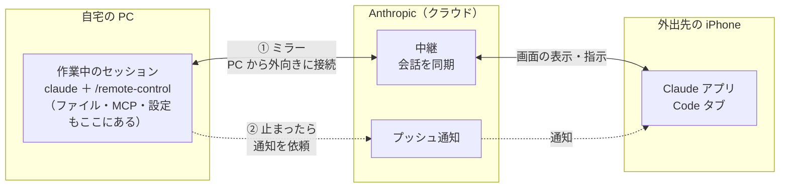

# リモートコントロールの設定手順（不在中の運用）

PC で長時間走らせている Claude Code を、外出先の iPhone から見て、質問や権限確認にも答えられるようにする手順書です。
**ミラー（見る・答える）・プッシュ通知（止まったら知らせる）・止まらない設定**の 3 つを、この順に設定します。

!!! info "基本は「モバイルからのリモートコントロール」を参照"
    リモートコントロールの仕組み・前提条件・3 つの起動方法は [モバイルからのリモートコントロール](mobile-remote-control.md) で解説しています。
    このページは、**一晩かけて自律実行させ、不在中に止まったら iPhone で気づいて答える**という使い方に絞った設定手順と、つまずきやすい点の切り分けです。

確認した環境: Claude Code 2.1.310（macOS）、iPhone の Claude アプリ、Team プラン。
一次資料: [Remote Control（公式ドキュメント）](https://code.claude.com/docs/en/remote-control)

## 仕組み（システム概要）



- **Claude Code は最初から最後まで PC で動きます。** iPhone は「その画面をのぞいて指示を返す窓」で、ファイルがクラウドへ上がるわけではありません。
- **PC からは外向きの HTTPS（443 番）だけを使います。** 起動時に Anthropic API へ登録して仕事を待ち、iPhone からの指示は Anthropic の中継を通って届きます。PC 側で受け付けのポートを開ける必要はありません。
- **① ミラーと ② 通知は別の経路です。** ① がつながっていても、② の設定（`/config` と iPhone の通知先の登録）が済んでいなければ通知は届きません。
- **③ 止まらない設定**（手順 3）は PC の中だけで完結する設定で、通信には関わりません。

## 先に要点

| やりたいこと | 必要なこと |
| --- | --- |
| iPhone からセッションを見る・答える（ミラー） | PC で `/remote-control`。iPhone の Claude アプリで**同じアカウント・同じ組織**にサインイン |
| 止まったときに iPhone へプッシュ通知 | `/config` の通知設定。PC と iPhone を同じアカウントにそろえる。**試験はどちらの端末でも操作していないときに行う** |
| 不在中に止まらないようにする | `autoContinueAtUsageLimit` などの設定とスリープ防止 |

!!! warning "ミラーと通知は別の仕組み"
    ミラーがつながっていても、`/config` に **No mobile registered** と出ていれば通知は届きません。

## 手順 1. ミラーする

### PC 側

1. 動いている Claude Code の入力欄で `/remote-control`（短縮形は `/rc`）と打ちます。
    - **先頭に空白を入れない。** 空白があるとコマンドではなく、ただのメッセージとして Claude に送られます。
    - Claude 自身はこのコマンドを実行できません。人間が打ちます。
2. **Enable Remote Control** を選びます。会話はそのまま引き継がれ、`/rc active` と出れば接続済みです。
3. もう一度 `/remote-control` と打つと、セッションの URL と QR コードが出ます。

**セッションを再起動する必要はありません。** 動いている作業を止めずに有効にできます。

### iPhone 側

1. Claude アプリを入れます。PC で `/mobile` と打つと、App Store への QR コードが出ます。
2. PC の Claude Code と**同じアカウント**でサインインします。Team / Enterprise プランなら**同じ組織**を選んでいることも確かめます。
3. 次のどちらかでセッションを開きます。
    - PC に出た QR コードを読み取る
    - アプリの **Code タブ**から、そのセッションを選ぶ
4. iPhone から 1 行送り、PC のセッションに届くことを確かめます。

### `/remote-control` と `claude rc` を取り違えない

| コマンド | 何をするか |
| --- | --- |
| `/remote-control`（セッション内） | **いま作業中のセッション**をミラーする |
| `claude rc`（別のターミナルで起動） | **新しいセッションの待ち受け**を立てる（基本編の「リモートコントロールを開始する」の[サーバーモード](mobile-remote-control.md)） |

アプリの「デバイスを追加」から組むと、PC の別タブで `claude rc` を実行する流れになります。
このとき iPhone がつながるのは**待ち受けのほう**で、そこから送ったメッセージは作業中のセッションに届きません。

!!! tip "どちらにつながっているかはセッション名で分かる"
    iPhone で開いたセッション名が、`claude rc` の画面に出ている名前（例: `macstudio-local-agile-tide`）と同じなら、待ち受けにつながっています。
    `claude rc` を `Ctrl-C` で止め、作業中のセッションで `/remote-control` を打って出した QR コードを読み直します
    （2 回目以降は `/rc active` ではなく QR コードを出す選択肢が出ます）。

    `claude rc` のタブを閉じても作業中のセッションは止まりませんが、**作業中のセッションのタブは閉じない**こと。閉じると作業も止まります。

### アカウントを切り替えたら、つなぎ直す

PC 側のログインアカウントを切り替えると、リモートコントロールは切れます。iPhone 側も同じアカウントでログインし直したうえで:

1. PC で `/remote-control` を打ち、**Enable Remote Control** を選ぶ
2. iPhone の Code タブからセッションを選ぶ。一覧に出なければ `/remote-control` で出る QR コードを読む

## 手順 2. プッシュ通知を設定する

### 設定の場所

| どこで | 何を |
| --- | --- |
| **PC**（`/config`） | **Push when actions required** をオン。権限確認や質問で止まったときに通知します |
| **PC**（`/config`・任意） | **Push when Claude decides** をオン。Claude が自分の判断で通知を送れるようになります（例: 全課題が終わった） |
| **iPhone**（設定 → 通知 → Claude） | 「通知を許可」・ロック画面・通知センターをオン |
| **iPhone**（設定 → 集中モード） | 夜間にも気づきたいなら、Claude を「通知を許可するアプリ」に追加 |

`/config` は PC のターミナル専用で、iPhone のアプリからは開けません。

!!! note "`settings.json` のキー名は未確認"
    `~/.claude/settings.json` に直接書く場合、**Push when actions required** は `inputNeededNotifEnabled` に当たるようです。
    `/config` のツール結果に `inputNeededNotifEnabled` と `agentPushNotifEnabled` が並んで返ってきたことからの推測で、**ドキュメントでは確かめていません。**

### 通知を試す: Claude に試しの通知を送らせる

Claude Code の通知ツールは、送れなかったときに理由を返します。これがいちばん早い切り分けです。

| 返ってきたもの | 原因 |
| --- | --- |
| `Push not sent — mobile push is disabled in /config.` | **Push when Claude decides** がオフ |
| `Not sent — this terminal is active` | 端末を**使用中**と判定された（下記） |
| `Terminal notification sent. Mobile push requested.` なのに届かない | iPhone 側（通知の許可・集中モード・サインインしているアカウント） |

!!! warning "操作中は通知が省かれる"
    PC のターミナルに打鍵中・前面にあるあいだだけでなく、**iPhone から操作しているあいだも「使用中」と判定され**、通知は送られません。
    操作中に「通知を送って」と頼むと、毎回省かれます。

**試験の手順**（操作していない状態を作ってから送らせる）:

1. Claude に「`sleep 120` をバックグラウンドで動かし、終わったら通知を送って」と頼む
2. その間に PC の画面をロックし、iPhone のアプリを閉じる
3. 2 分後、iPhone に通知が届くことを確かめる

### つまずいた点: No mobile registered

`/config` に **No mobile registered** と出るのは、iPhone がこのアカウントの通知先として 1 台も登録されていない、という意味です。
iPhone 側の通知許可が正しく、ミラーも成功しているのに、この表示が消えないことがあります。

切り分けの順:

1. **PC と iPhone のアカウント・組織が一致しているか。** いちばん疑わしい原因です。Code タブに作業中のセッションが出れば、両方とも合っています。実際の解決もこれで、**同じアカウントでログインし直したら止まらなくなりました。**
2. **iPhone で一度 Claude アプリを開く。** 通知トークンが更新されます。
3. **新しく起動したプロセスで `/config` を開く。** 起動中のセッションは、起動時の登録情報を持ったままになっている可能性があります（確かめてはいません）。
4. それでも駄目なら `claude doctor` を実行するか、組織の Owner に管理画面の設定を見てもらいます。

!!! note "組織設定で通知を止められるかは未確認"
    ミラーできている以上、組織でリモートコントロールが有効なことは確かです。ただし組織設定で**通知だけ**を止められるかは、ドキュメントでは確かめられませんでした。

## 手順 3. 通知が無くても止まらないようにする

通知は「止まったことに気づく」ための手段です。不在中の運用では、**そもそも止まらない設定**のほうが効きます。

### `~/.claude/settings.json`

```json
{
  "autoContinueAtUsageLimit": true,
  "inputNeededNotifEnabled": true,
  "askUserQuestionTimeout": "5m"
}
```

| キー | 効果 |
| --- | --- |
| `autoContinueAtUsageLimit` | 利用上限で止まったら、上限が戻るのを待って自動で続ける |
| `inputNeededNotifEnabled` | 権限確認や質問で止まったときに通知する（端末の登録が済んでいる場合。キー名は上の注記のとおり未確認） |
| `askUserQuestionTimeout` | 質問が出ても、指定時間（例: 5 分）で自動的に先へ進む |

よく使う読み取り系のコマンドは許可ルール（`permissions.allow`）に入れておくと、権限確認で止まりにくくなります（[実行モードと権限管理](execution-modes.md)）。

### PC 側

- **スリープさせない。** 別のターミナルで `caffeinate -dims` を動かし、電源につないで蓋を開けたままにします（macOS）。
- **ネットワークを切らない。** 約 10 分以上つながらないとセッションがタイムアウトします。

## チェックリスト

1. PC で `/remote-control` → iPhone の Code タブで**作業中のセッション**が開ける（`claude rc` の待ち受けではない）
2. iPhone から送った 1 行が PC のセッションに届く
3. `/config` に **No mobile registered** が出ていない
4. **両方の端末で操作していない状態で**送らせた試しの通知が iPhone に届く
5. `settings.json` に止まらない設定が入り、`caffeinate` が動いている

## 関連リンク

- [モバイルからのリモートコントロール](mobile-remote-control.md)（基本編）
- [Remote Control 公式ドキュメント](https://code.claude.com/docs/en/remote-control)
- [実行モードと権限管理](execution-modes.md)
